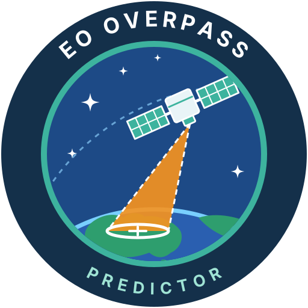
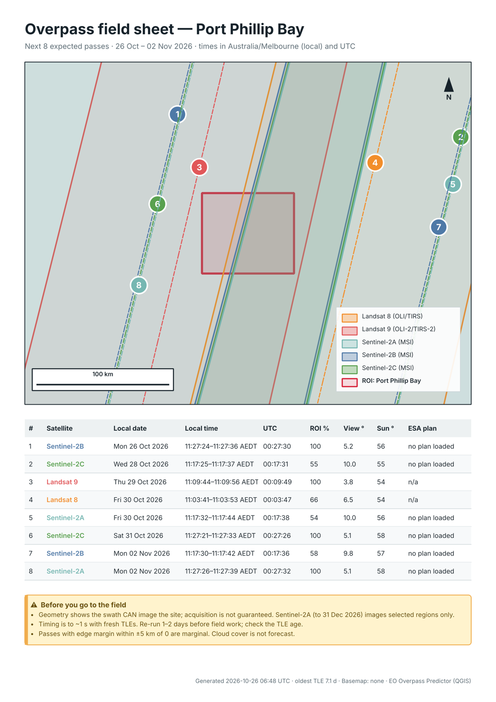
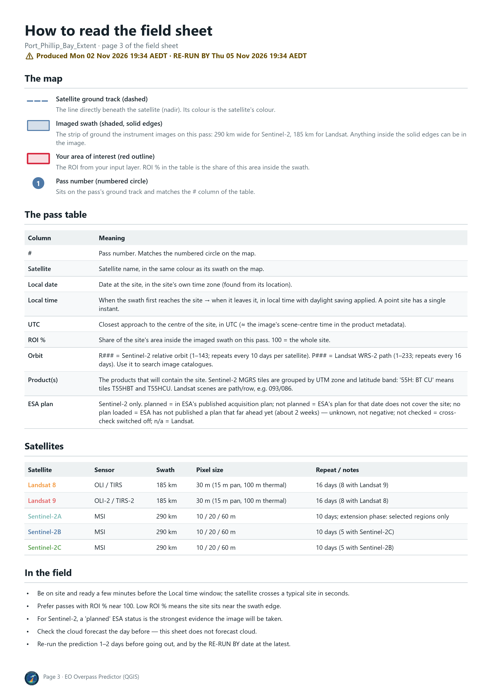
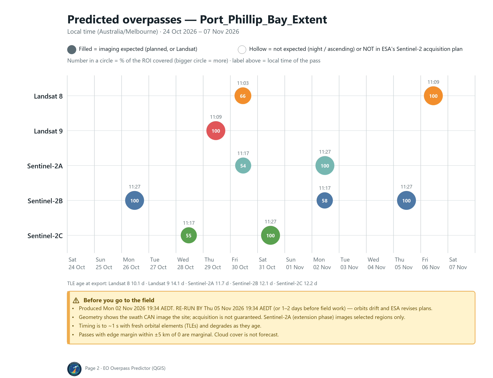
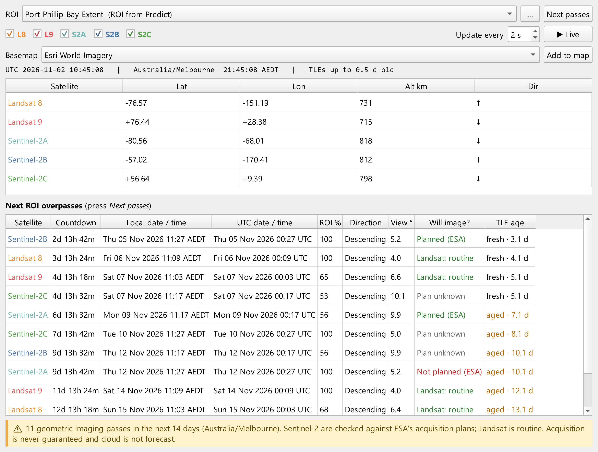
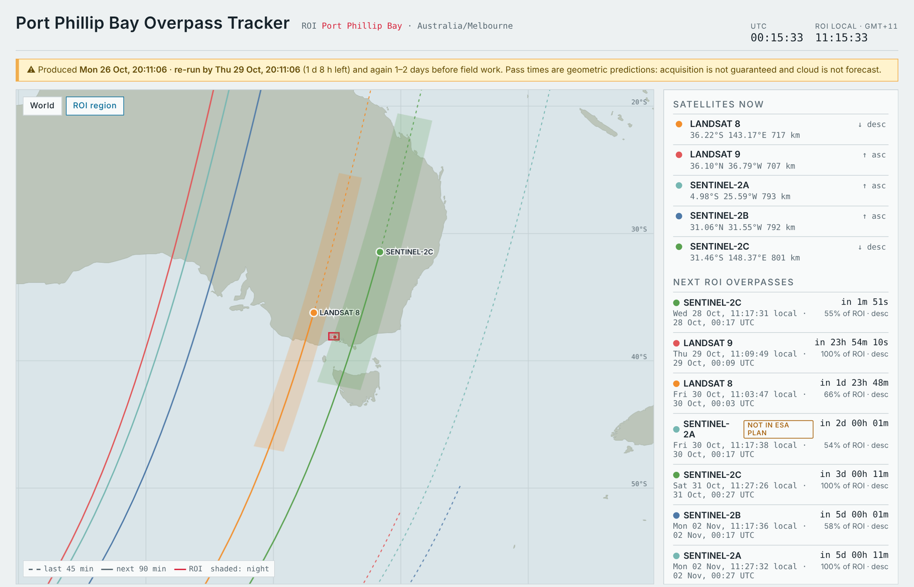

# 🧑‍💻 eo-overpass-qgis

<table align="right">
  <tr>
    <td align="center">
      
      <br>
      <b>👤 Julian Manning</b>
      <br>
      <sub>♻️ Last updated: <b>November 2026</b></sub>
      <br>
      <sub>📝 <b>QGIS plugin · Landsat / Sentinel-2</b></sub>
      <br>
      <sub>📧 <a href="mailto:julian.manning@outlook.com">julian.manning@outlook.com</a></sub>
      <br>
      <sub>🔗 Connect on <a href="https://www.linkedin.com/in/julian-manning/">LinkedIn</a></sub>
    </td>
  </tr>
</table>

[](https://doi.org/10.5281/zenodo.23884833)

**EO Overpass Predictor** for QGIS answers one question for field and GIS teams: **when will Landsat 8/9 or Sentinel-2A/B/C actually image my site?** It predicts every imaging overpass of your ROI layers from current orbits, using the true **instrument swath**, reports each pass in **UTC and the site's local time**, cross-checks Sentinel-2 against **ESA's acquisition plans**, and exports **printable field packs**: CSV, a live-tracker web page and PNG sheets you can take to the field. A **live tracker dock** shows the satellites moving over your own map.

It is the QGIS companion to the notebook toolkit [eo-overpass-predictor](https://github.com/julianManning/eo-overpass-predictor) ([DOI: 10.5281/zenodo.23629976](https://doi.org/10.5281/zenodo.23629976)) and uses the same validated engine.

<br clear="right">

---

## ⚡ Features

* **Swath-aware, geodetically accurate.** SGP4 orbits from CelesTrak TLEs; each instrument's footprint (MSI 290 km, OLI 185 km) is built with WGS84 geodesics and intersected with the ROI in an ROI-centred equal-area projection, so swath width is true at any latitude.
* **Per-pass diagnostics.** % of the ROI covered, ROI entry/exit and scene-centre times, nadir offset and side of track, edge margin, view angle, satellite elevation, sun elevation, TLE age.
* **Local time done right.** Each ROI's IANA time zone is found offline from its location; times are converted with the daylight-saving offset in force on each date.
* **Will it be acquired?** Built into Predict: Sentinel-2 passes are labelled *planned (NOMINAL)*, *not planned* or *no plan loaded* from ESA's published plans (Sentinel-2A is in its extension phase and images selected regions only).
* **Which product will it be?** Each pass carries its orbit — Sentinel-2 relative orbit (`R116`) or Landsat WRS-2 path (`P093`) — and the product IDs that cover the ROI: Sentinel-2 MGRS tiles (`T55HCU`) or Landsat path/rows (`093/086`). An optional **products layer** draws their footprints.
* **Results carry an expiry.** Every output is stamped *Produced …* and *Re-run by …* (default 3 days, adjustable). The HTML tracker shows a yellow banner with time left that turns red once it has expired. Re-run Predict to refresh everything.
* **Pick your satellites.** One tick box per satellite (all ticked by default); tick boxes in the live tracker too.
* **Many sites at once.** One pass set per ROI feature (named from a name/site field automatically), or dissolve all features into one ROI.
* **QGIS-native output.** A styled, **time-enabled** pass layer — step through passes with the Temporal Controller.
* **Field pack per ROI** — ready to print (optional: choose a folder in Predict):
  * `overpasses_<roi>.csv` — ISO-8601 UTC and local times with explicit offsets;
  * `live_tracker_<roi>.html` — standalone live tracker (opens in any browser);
  * `field_sheet_<roi>.pdf` — **printable A4 field sheet**: page 1 is a map of the next passes over the ROI (dashed line = satellite ground track, solid edges = imaged swath) with a numbered pass table (orbit, product IDs, ESA plan) and field cautions; page 2 is the pass timeline (filled circle = imaging expected, hollow = not expected or not in ESA's plan); the following pages explain every symbol and column, the satellites and the CSV, so anyone can read it. Text is vector, so it stays sharp when printed or zoomed;
* **Live tracker dock.** Opens by itself after Predict (it is not a separate tool; if you close it, reopen it from the QGIS Panels menu or run Predict again) and works even if the ROI is not a map layer. Positions, past/future ground tracks, current swaths and the night side on the map canvas, with UTC/local clocks and the next 14 days of ROI passes (countdown, local and UTC date/time, direction, view angle, ESA plan status, TLE age). If the map is in a local projection (e.g. UTM), it offers to switch to WGS 84 while tracking and restores your CRS on pause.
* **Basemaps.** Esri World Imagery (default) and OpenStreetMap — for the field sheet, and optionally added to your QGIS map from Predict and the live tracker. A bundled **offline Natural Earth 10 m land/sea** basemap sits under every field-sheet map, so sheets stay readable without internet.
* **Automation-ready.** Processing algorithms work in the Graphical Modeler, batch mode, PyQGIS (`processing.run`) and `qgis_process`.
* **Zero setup.** No account, no API key; pure-Python dependencies (sgp4, geographiclib, tzdata) are bundled. Runs on QGIS 3.34+ and QGIS 4 (Qt6).

---

## 🗺️ Example outputs

| A4 field sheet — page 1 | Page 3: how to read it |
| :---: | :---: |
|  |  |

| Pass timeline (page 2 of the PDF) | Live tracker dock |
| :---: | :---: |
|  |  |

| Standalone live tracker (HTML page in the field pack) |
| :---: |
|  |

*Port Phillip Bay (Victoria), example run of 2 Nov 2026 with the Esri World Imagery basemap. The ESA cross-check was switched off for these example images, so the plan column reads "not checked".*

---

## 🧰 Tools

**Processing Toolbox ▸ EO Overpass** (also under the **Plugins ▸ EO Overpass** menu):

| Algorithm | What it does |
| :--- | :--- |
| **Predict overpasses** | The main tool. ROI layer → pass layer, products layer and field pack. Downloads fresh orbital elements (TLEs), predicts passes for the ticked satellites, cross-checks Sentinel-2 passes against ESA's acquisition plans, and stamps everything with a produced / re-run-by date. **Re-run it before field work** — that refreshes both the orbits and the ESA plans. |

*Advanced parameters* of Predict: validity period (days, default 3), swath strip length drawn per pass (km, default 350), minimum sun elevation, time-zone override, maximum TLE age, and pasted TLEs to override CelesTrak.

**Live tracker**: opens by itself after **Predict overpasses**, already filled with the ROI you gave Predict (a file path is enough, no map layer needed) and its next passes. Press **▶ Live** to animate the satellites on the map. To track a different ROI, pick a layer or press **…** to choose a file, then **Next passes**.

---

## 📖 User guide

[**EO Overpass Predictor — User Guide**](docs/EO_Overpass_Predictor_User_Guide.pdf) (PDF, 20 pages; [Word version](docs/EO_Overpass_Predictor_User_Guide.docx)) walks through the Port Phillip Bay example and covers installation, every parameter, every output and column, the live tracker, expiry stamps, accuracy and validation, automation (PyQGIS, `qgis_process`), troubleshooting and a glossary. It is bundled with the plugin: **Plugins ▸ EO Overpass ▸ Help (user guide)**, or the **Help** button of the tool. **Plugins ▸ EO Overpass ▸ About** shows the version, author, links, citation and credits.

---

## 🚀 Install

**From the QGIS plugin repository** (once published): *Plugins ▸ Manage and Install Plugins*, search **EO Overpass Predictor**.

**From ZIP:** download `eo_overpass_qgis.zip` from the [Releases](https://github.com/julianManning/eo-overpass-qgis/releases) page, then *Plugins ▸ Manage and Install Plugins ▸ Install from ZIP*.

**From source:** copy the `eo_overpass` folder into your QGIS profile's `python/plugins` folder (on Windows `%APPDATA%\QGIS\QGIS3\profiles\default\python\plugins`) and enable it.

Network access is needed to `celestrak.org` (TLEs) and `sentinels.copernicus.eu` (plans); proxies set in QGIS are honoured. Basemap tiles come from OpenStreetMap or Esri; each provider's terms of use apply. For other tile sources, add them yourself (e.g. with the QuickMapServices plugin).

---

## ⚠️ Read before relying on a pass

* **Geometry, not guarantees.** A pass means the swath *can* image the ROI. Acquisition depends on the mission plan, downlink and processing. Landsat schedules >99% of daytime land and near-shore scenes (LTAP) but is not cross-checked here.
* **TLE age matters.** With fresh TLEs, predicted times matched delivered scenes within ~1 s; with 23-day-old elements the error reached ~12 s. **Re-run 1–2 days before field work.**
* **Swath edges are nominal.** Treat passes with `edge_margin_km` within ±5 km of 0 as possible, not certain.
* **Product IDs are computed, not looked up.** Relative orbit, WRS-2 path/row and MGRS tile names come from the predicted orbit and grid rules (checked against delivered scenes and tile names). Tile footprints are drawn as the 109.8 km square from the MGRS 100 km square's corner, and WRS-2 frames as nominal 185 × 180 km rectangles — close to, but not identical with, the official grids.
* **"No plan loaded" is unknown, not negative.** ESA publishes plans ~2 weeks ahead; ESA's footprints are simplified, so a "not planned" edge pass can be a footprint artefact.
* **Cloud cover is not forecast.**

---

## ✅ Validation

`tests/test_engine.py` (run with QGIS's Python) checks predictions against delivered acquisitions — Landsat 9 scene centres and Sentinel-2B granule times, including a swath-edge sliver — to within 1.5 s, and checks parity with the notebook engine for the Port Phillip Bay example, and checks orbit, path/row and MGRS tile IDs.

```bash
python tests/test_engine.py
```

---

## 🏷️ Releasing (maintainer notes)

Release details live in **one file**, `eo_overpass/about.json` (author, LinkedIn, repository, release date, DOI); the version lives in `eo_overpass/metadata.txt`. After changing either, run:

```bash
python scripts/set_release_info.py --doi 10.5281/zenodo.XXXXXXX --date YYYY-MM-DD
python scripts/package.py
```

This updates the **About** dialog (it reads `about.json`), `CITATION.cff`, and the user guide (`docs/*.docx`: title page, footer, "How to cite", DOI line) and re-exports both guide PDFs (`docs/` and the copy bundled in the plugin) using LibreOffice, or Word via `pip install docx2pdf`. Use Zenodo's **concept DOI** ("cite all versions") so it never has to change again.

---

## 📂 Repository structure

```text
eo-overpass-qgis/
├── eo_overpass/                 # the plugin (zip this folder to install)
│   ├── metadata.txt, icon.svg/png, badge.png, __init__.py, plugin.py, provider.py
│   ├── algorithms/              # Processing algorithms
│   ├── core/                    # TLEs, SGP4 orbits, geodesy, prediction, time zones, ESA plans, records
│   ├── exports/                 # CSV, HTML tracker, field-sheet PDF (sheet, timeline, guide pages)
│   ├── live/                    # live tracker dock
│   ├── data/                    # coastlines, time-zone grid, tracker template
│   └── ext/                     # bundled sgp4, geographiclib, tzdata
├── examples/                    # Port Phillip Bay test ROI (GeoPackage)
├── tests/                       # validation tests + fixture TLEs
├── scripts/                     # package.py (builds dist/eo_overpass_qgis.zip), set_release_info.py, hires_pdf.py
└── docs/                        # user guide (.docx/.pdf) and README images
```

---

## 🔗 Related
* **[eo-overpass-predictor](https://github.com/julianManning/eo-overpass-predictor)** ([DOI: 10.5281/zenodo.23629976](https://doi.org/10.5281/zenodo.23629976)) — the Python/Jupyter version.
* **[cdse-sentinel2-pipeline](https://github.com/julianManning/cdse-sentinel2-pipeline)** and **[cdse-sentinel1-pipeline](https://github.com/julianManning/cdse-sentinel1-pipeline)** — download the scenes once acquired.

## 📚 Citation & attribution
* **Citing this software:** use **"Cite this repository"** (from `CITATION.cff`).
* **TLEs:** [CelesTrak](https://celestrak.org/) (US Space Force data via space-track.org). **Plans:** © ESA, [Sentinel-2 acquisition plans](https://sentinels.copernicus.eu/copernicus/sentinel-2/acquisition-plans).
* **Coastlines and offline land/sea:** [Natural Earth](https://www.naturalearthdata.com/) 10 m and 50 m (public domain). **Time-zone grid:** derived from [timezone-boundary-builder](https://github.com/evansiroky/timezone-boundary-builder), © OpenStreetMap contributors, ODbL.
* **Bundled libraries:** [sgp4](https://pypi.org/project/sgp4/) (MIT), [geographiclib](https://geographiclib.sourceforge.io/) (MIT), [tzdata](https://pypi.org/project/tzdata/) (Apache-2.0); [satellite.js](https://github.com/shashwatak/satellite-js) (MIT) is embedded in the HTML tracker.

## 🛡️ License
GNU General Public License v2.0 or later — see [LICENSE](LICENSE). Bundled third-party libraries keep their own licences (see `eo_overpass/ext/*/LICENSE`).
