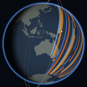
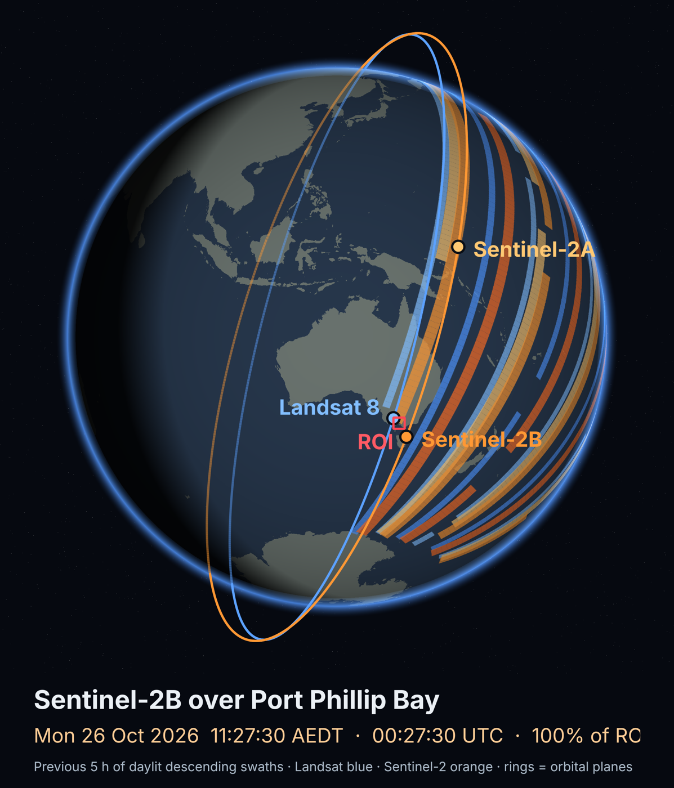
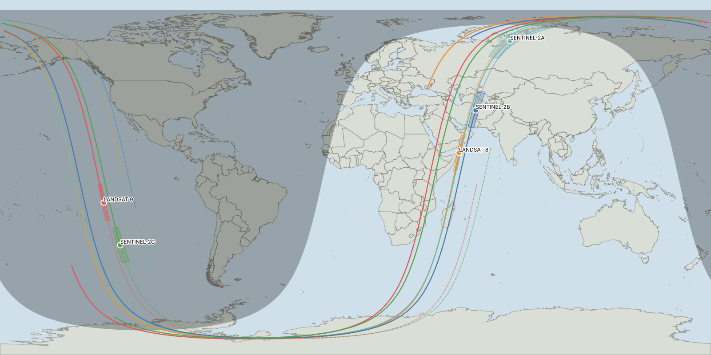

# 🧑‍💻 eo-overpass-qgis

<table align="right">
  <tr>
    <td align="center">
      
      <br>
      <b>👤 Julian Manning</b>
      <br>
      <sub>♻️ Last updated: <b>October 2026</b></sub>
      <br>
      <sub>📝 <b>QGIS plugin · Landsat / Sentinel-2</b></sub>
      <br>
      <sub>📧 <a href="mailto:julian.manning@outlook.com">julian.manning@outlook.com</a></sub>
      <br>
      <sub>🔗 Connect on <a href="https://www.linkedin.com/in/julian-manning/">LinkedIn</a></sub>
    </td>
  </tr>
</table>

**EO Overpass Predictor** for QGIS answers one question for field and GIS teams: **when will Landsat 8/9 or Sentinel-2A/B/C actually image my site?** It predicts every imaging overpass of your ROI layers from current orbits, using the true **instrument swath**, reports each pass in **UTC and the site's local time**, cross-checks Sentinel-2 against **ESA's acquisition plans**, and exports **printable field packs**: CSV, a live-tracker web page and PNG sheets you can take to the field. A **live tracker dock** shows the satellites moving over your own map.

It is the QGIS companion to the notebook toolkit [eo-overpass-predictor](https://github.com/julianManning/eo-overpass-predictor) ([DOI: 10.5281/zenodo.23629976](https://doi.org/10.5281/zenodo.23629976)) and uses the same validated engine.

<br clear="right">

---

## ⚡ Features

* **Swath-aware, geodetically accurate.** SGP4 orbits from CelesTrak TLEs; each instrument's footprint (MSI 290 km, OLI 185 km) is built with WGS84 geodesics and intersected with the ROI in an ROI-centred equal-area projection, so swath width is true at any latitude.
* **Per-pass diagnostics.** % of the ROI covered, ROI entry/exit and scene-centre times, nadir offset and side of track, edge margin, view angle, satellite elevation, sun elevation, TLE age.
* **Local time done right.** Each ROI's IANA time zone is found offline from its location; times are converted with the daylight-saving offset in force on each date.
* **Will it be acquired?** Sentinel-2 passes are labelled *planned (NOMINAL)*, *not planned* or *no plan loaded* from ESA's published plans (Sentinel-2A images selected regions only until 31 Dec 2026).
* **Many sites at once.** One pass set per ROI feature (named from a field), or dissolve all features into one ROI.
* **QGIS-native output.** A styled, **time-enabled** pass layer — step through passes with the Temporal Controller.
* **Field pack per ROI** — ready to print:
  * `overpasses_<roi>.csv` — ISO-8601 UTC and local times with explicit offsets;
  * `live_tracker_<roi>.html` — standalone live tracker (opens in any browser);
  * `timeline_<roi>.png` — pass calendar with local times;
  * `field_sheet_<roi>.png` — **A4 sheet at 300 dpi**: map of the next passes' swaths over the ROI, numbered pass table, field cautions;
  * `orbit_globe_<roi>.png` — orbits and swaths at the featured pass.
* **Live tracker dock.** Positions, past/future ground tracks, current swaths and the night side on the map canvas, with UTC/local clocks and a countdown to the next ROI passes.
* **Automation-ready.** Processing algorithms work in the Graphical Modeler, batch mode, PyQGIS (`processing.run`) and `qgis_process`.
* **Zero setup.** No account, no API key; pure-Python dependencies (sgp4, geographiclib, tzdata) are bundled. Runs on QGIS 3.34+ and QGIS 4 (Qt6).

---

## 🗺️ Example outputs

| A4 field sheet | Pass timeline |
| :---: | :---: |
|  |  |

| Orbit globe | Live tracker layers |
| :---: | :---: |
|  |  |

*Port Phillip Bay (Victoria), 24 Oct – 9 Nov 2026. The example field sheet was rendered offline without a basemap, so ESA plan status shows "no plan loaded".*

---

## 🧰 Tools

**Processing Toolbox ▸ EO Overpass** (also under the **Plugins ▸ EO Overpass** menu):

| Algorithm | What it does |
| :--- | :--- |
| **Predict overpasses** | ROI layer → pass layer (+ optional field pack). Window, satellites, daytime/descending filter, minimum sun elevation and coverage, time-zone override, ESA cross-check. |
| **Cross-check Sentinel-2 acquisition plans** | Re-checks an existing pass layer against the latest ESA plans (or a folder of KMLs). |
| **Export field pack** | Writes CSV, HTML tracker and PNGs from an existing pass layer. |
| **Refresh orbital elements (TLEs)** | Updates the TLE cache; paste your own TLEs to override. |

**Live tracker** (toolbar button): choose an ROI layer, press **Next passes**, then **▶ Live**.

---

## 🚀 Install

**From the QGIS plugin repository** (once published): *Plugins ▸ Manage and Install Plugins*, search **EO Overpass Predictor** (enable *Show also experimental plugins*).

**From ZIP:** download `eo_overpass.zip` from the [Releases](https://github.com/julianManning/eo-overpass-qgis/releases) page, then *Plugins ▸ Manage and Install Plugins ▸ Install from ZIP*.

**From source:** copy the `eo_overpass` folder into your QGIS profile's `python/plugins` folder (on Windows `%APPDATA%\QGIS\QGIS3\profiles\default\python\plugins`) and enable it.

Network access is needed to `celestrak.org` (TLEs) and `sentinels.copernicus.eu` (plans); proxies set in QGIS are honoured. Basemap tiles for the field sheet come from OpenStreetMap or Esri.

---

## ⚠️ Read before relying on a pass

* **Geometry, not guarantees.** A pass means the swath *can* image the ROI. Acquisition depends on the mission plan, downlink and processing. Landsat schedules >99% of daytime land and near-shore scenes (LTAP) but is not cross-checked here.
* **TLE age matters.** With fresh TLEs, predicted times matched delivered scenes within ~1 s; with 23-day-old elements the error reached ~12 s. **Re-run 1–2 days before field work.**
* **Swath edges are nominal.** Treat passes with `edge_margin_km` within ±5 km of 0 as possible, not certain.
* **"No plan loaded" is unknown, not negative.** ESA publishes plans ~2 weeks ahead; ESA's footprints are simplified, so a "not planned" edge pass can be a footprint artefact.
* **Cloud cover is not forecast.**

---

## ✅ Validation

`tests/test_engine.py` (run with QGIS's Python) checks predictions against delivered acquisitions — Landsat 9 scene centres and Sentinel-2B granule times, including a swath-edge sliver — to within 1.5 s, and checks parity with the notebook engine for the Port Phillip Bay example.

```bash
python tests/test_engine.py
```

---

## 📂 Repository structure

```text
eo-overpass-qgis/
├── eo_overpass/                 # the plugin (zip this folder to install)
│   ├── metadata.txt, icon.png, __init__.py, plugin.py, provider.py
│   ├── algorithms/              # Processing algorithms
│   ├── core/                    # TLEs, SGP4 orbits, geodesy, prediction, time zones, ESA plans, records
│   ├── exports/                 # CSV, HTML tracker, timeline / field-sheet / globe PNGs
│   ├── live/                    # live tracker dock
│   ├── data/                    # coastlines, time-zone grid, tracker template
│   └── ext/                     # bundled sgp4, geographiclib, tzdata
├── tests/                       # validation tests + fixture TLEs
├── scripts/package.py           # builds dist/eo_overpass.zip
└── docs/img/                    # README images
```

---

## 🔗 Related
* **[eo-overpass-predictor](https://github.com/julianManning/eo-overpass-predictor)** ([DOI: 10.5281/zenodo.23629976](https://doi.org/10.5281/zenodo.23629976)) — the Python/Jupyter version.
* **[cdse-sentinel2-pipeline](https://github.com/julianManning/cdse-sentinel2-pipeline)** and **[cdse-sentinel1-pipeline](https://github.com/julianManning/cdse-sentinel1-pipeline)** — download the scenes once acquired.

## 📚 Citation & attribution
* **Citing this software:** use **"Cite this repository"** (from `CITATION.cff`).
* **TLEs:** [CelesTrak](https://celestrak.org/) (US Space Force data via space-track.org). **Plans:** © ESA, [Sentinel-2 acquisition plans](https://sentinels.copernicus.eu/copernicus/sentinel-2/acquisition-plans).
* **Coastlines:** [Natural Earth](https://www.naturalearthdata.com/) (public domain). **Time-zone grid:** derived from [timezone-boundary-builder](https://github.com/evansiroky/timezone-boundary-builder), © OpenStreetMap contributors, ODbL.
* **Bundled libraries:** [sgp4](https://pypi.org/project/sgp4/) (MIT), [geographiclib](https://geographiclib.sourceforge.io/) (MIT), [tzdata](https://pypi.org/project/tzdata/) (Apache-2.0); [satellite.js](https://github.com/shashwatak/satellite-js) (MIT) is loaded by the HTML tracker.

## 🛡️ License
GNU General Public License v2.0 or later — see [LICENSE](LICENSE). Bundled third-party libraries keep their own licences (see `eo_overpass/ext/*/LICENSE`).
